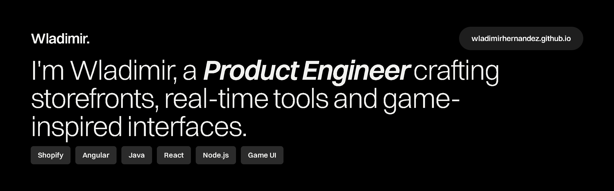
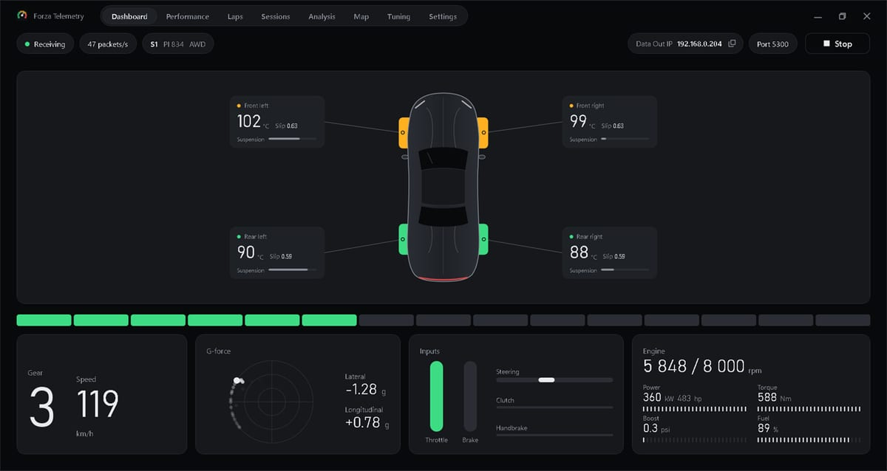
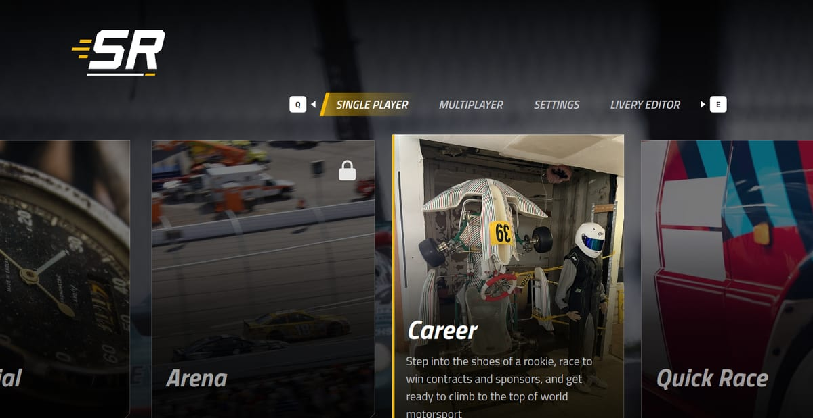

### Product Engineer · Senior Full Stack Developer

8+ years of commercial experience building, scaling and optimizing digital products, e-commerce platforms and enterprise applications, and coding since I was 14. Today I'm a Product Engineer at **Solo Media Group**, working across the Shopify ecosystem: themes, apps, Functions and checkout extensions in Rust/WebAssembly.

**[Portfolio](https://wladimirhernandez.github.io)** · **[Portafolio en español](https://wladimirhernandez.github.io/es/)** · **[LinkedIn](https://www.linkedin.com/in/wladimir-hernandez)** · **[Email](mailto:wladimirhernandezdev@gmail.com)**

---

### Recent work

<table>
  <tr>
    <td width="50%" valign="top">
      
      
<strong><a href="https://github.com/wladimirhernandez/forza-telemetry">Forza Telemetry</a></strong> 
      Live telemetry for Forza Horizon 6: dashboard, laps, recordings, map and tuning hints. 
      .NET · WPF · Real-time

    </td>
    <td width="50%" valign="top">
      
      
<strong><a href="https://github.com/wladimirhernandez/car-game-ui">Car Game UI</a></strong> 
      A racing game menu built with the NoesisGUI native C++ SDK. 
      C++ · NoesisGUI · XAML · MVVM

    </td>
  </tr>
</table>

Storefronts I've worked on at Solo Media Group: [Lifelines](https://www.lifelines.com) · [Thirteen Lune](https://thirteenlune.com) · [LA Archive](https://losangelesarchive.com). More on the [portfolio](https://wladimirhernandez.github.io).

---

### Stack

- **Product & e-commerce:** Shopify (Liquid, Functions, custom apps, APIs) · Rust (WebAssembly) · Technical SEO · Core Web Vitals · Accessibility
- **Frontend:** Angular · TypeScript · Vue.js · React · Next.js · Astro · Ionic · Tailwind CSS · GSAP
- **Backend & cloud:** Java · Spring Boot · Node.js (NestJS) · Python (FastAPI) · PHP (Laravel) · AWS (Lambda, S3) · Docker · CI/CD
- **AI, automation & QA:** AI-assisted development (Claude Code, Gemini) · RPA (Selenium) · Playwright · Vitest · JUnit · Jest
- **Data:** MySQL · PostgreSQL · MongoDB · Supabase
- **Desktop & game UI:** C++ · C# (.NET, WPF) · NoesisGUI (XAML)

<strong>Español</strong>

### Product Engineer · Senior Full Stack Developer

Más de 8 años de experiencia comercial creando, escalando y optimizando productos digitales, plataformas de e-commerce y aplicaciones empresariales, y programando desde los 14 años. Hoy soy Product Engineer en **Solo Media Group** y trabajo en todo el ecosistema Shopify: temas, apps, Functions y extensiones de checkout en Rust/WebAssembly.

**Trabajo reciente:** [Forza Telemetry](https://github.com/wladimirhernandez/forza-telemetry), telemetría en vivo para Forza Horizon 6, y [Car Game UI](https://github.com/wladimirhernandez/car-game-ui), el menú de un juego de carreras hecho con NoesisGUI y C++. Tiendas en las que trabajé en Solo Media Group: [Lifelines](https://www.lifelines.com), [Thirteen Lune](https://thirteenlune.com) y [LA Archive](https://losangelesarchive.com).

**[Portafolio](https://wladimirhernandez.github.io/es/)** · **[LinkedIn](https://www.linkedin.com/in/wladimir-hernandez)** · **[Email](mailto:wladimirhernandezdev@gmail.com)**

